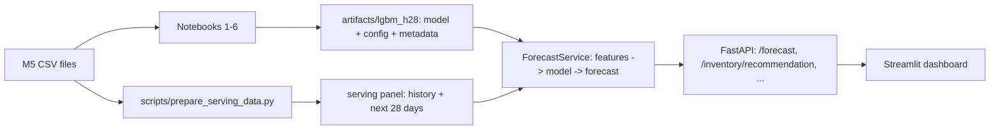

# Retail Demand Forecasting and Inventory Decision Support (M5)

An end-to-end project on the M5 (Walmart) dataset: exploratory analysis, leakage-safe feature engineering, a tuned LightGBM
demand model, a comparison with a foundation model (Chronos-2) and a deep-learning model (TFT), an untouched final holdout,
an assumption-based inventory simulation, and a deployed service (FastAPI + Streamlit + Docker + CI/CD).

> **Scope.** The model uses a stratified sample of **999 California item-store series (about 3.3% of M5's 30,490 series)**.
> The inventory part is a **simulation under stated assumptions**: M5 contains no inventory, lead-time or cost data.

## Results (measured)

| | LightGBM | 28-day moving average |
|---|---|---|
| Final holdout, daily WAPE | **0.744** | 0.789 |
| Final holdout, 7-day-sum WAPE | **0.370** | 0.416 |
| Daily improvement, 95% bootstrap CI | **5.7%** (2.9% to 9.1%) | |

* Model choice: Chronos-2 had a better daily WAPE on the validation folds (0.712) but under-forecast total demand by about 31%; LightGBM won on
  7-day/28-day totals and bias. TFT (one configuration) did not work well.
* Simulated inventory backtest: a 5.7% better forecast changed total simulated cost by only about -1.7% (95% CI -3.2% to -0.3%) and by about 0%
  at equal service level, because demand randomness dominates cost for sparse demand.
* Known weaknesses: sparse/intermittent series (no gain over the baseline), about 7% under-forecast of total demand, new items unsupported.
  See [`docs/MODEL_CARD.md`](docs/MODEL_CARD.md).

## Architecture



Key design choices
* **One feature module** (`src/retail_forecast/features.py`) is used for training, evaluation and serving, so they cannot drift apart. A test proves that
  sales-based features cannot see the future.
* **Models are plug-ins.** The service only uses the `Forecaster` interface (`models.py`). Replacing the model is a configuration change, not a code change.
* **Data contract.** The serving panel is validated (`data.py`): no duplicates, complete daily panel, no sales in the forecast window.
* **Degraded mode.** If the model or data are missing, the API still starts; `/health` reports `degraded` and the forecast endpoints return 503.

## Repository layout

```
notebooks/      01 EDA, 02 features, 03 LightGBM, 04 Chronos-2 vs TFT, 05 final holdout, 06 inventory simulation
src/retail_forecast/   features.py, data.py, models.py, predict.py, inventory.py, config.py, demo.py
api/            FastAPI app and schemas
dashboard/      Streamlit app
scripts/        prepare_serving_data.py, register_model.py, make_demo_artifacts.py
configs/        model.yaml (real model), demo.yaml (synthetic demo)
artifacts/      versioned model files        reports/   result files from the notebooks
tests/          pytest suite (no M5 data needed)
.github/workflows/   ci.yml (lint, tests, Docker smoke test), release.yml (publish images on a version tag)
```

## Quick start (Windows, PowerShell, Python 3.12)

```powershell
git clone <your-repo-url>
cd retail-decision-intelligence
py -3.12 -m venv .venv
.\.venv\Scripts\Activate.ps1          # if blocked: Set-ExecutionPolicy -Scope CurrentUser RemoteSigned
python -m pip install --upgrade pip
pip install -r requirements-dev.txt
pytest
```

### Demo without the M5 files (synthetic data)
```powershell
python scripts/make_demo_artifacts.py
$env:RETAIL_CONFIG = "configs/demo.yaml"
uvicorn api.main:app --reload                 # API docs: http://localhost:8000/docs
# second terminal (activate the venv again):
streamlit run dashboard/app.py                # http://localhost:8501
```
The demo model and data are synthetic; the numbers are meaningless.

### With the real model
1. Download from the Kaggle notebook outputs: `lgbm_final_h28.txt`, `lgbm_config_h28.json` (Notebook 3), `holdout_runs.jsonl`, `m5_sample_long_ext.parquet`
   (Notebook 5), `inventory_results.json` (Notebook 6). Put the two JSON/JSONL reports in `reports/`, the parquet in `data/processed/`, and the M5 `calendar.csv`
   and `sell_prices.csv` in `data/raw/`.
2. Register the model and build the serving data:
```powershell
python scripts/register_model.py --name lgbm_h28 --model-file path\to\lgbm_final_h28.txt --config-file path\to\lgbm_config_h28.json `
    --holdout-log reports\holdout_runs.jsonl --trained-through 2016-04-24 --version v1 --activate
python scripts/prepare_serving_data.py
uvicorn api.main:app
```
The forecast window of the real serving panel is 2016-05-23 to 2016-06-19, the 28 days after the data used in the notebooks.

### Docker
```powershell
docker compose up --build       # API on :8000, dashboard on :8501; ./data is mounted read-only
```

### Calling the API
```powershell
Invoke-RestMethod "http://localhost:8000/series?limit=3"
Invoke-RestMethod -Method Post -Uri http://localhost:8000/forecast -ContentType "application/json" `
    -Body '{"series_id":"<an id from /series>","horizon":14}'
Invoke-RestMethod -Method Post -Uri http://localhost:8000/inventory/recommendation -ContentType "application/json" `
    -Body '{"series_id":"<an id>","on_hand":5,"lead_time_days":7,"review_period_days":7,"service_level":0.95}'
```

| Endpoint | Purpose |
|---|---|
| `GET /health` | `ok` or `degraded` (model/data not loaded) |
| `GET /model-info` | model name, version, checksum, data cut-off, limitations |
| `GET /series`, `GET /history/{id}` | browse series and recent sales |
| `POST /forecast` | 1 to 28 day forecast for a series |
| `POST /inventory/recommendation` | order quantity under an order-up-to policy, with the formulas and assumptions |

## CI/CD

* **CI** (`ci.yml`, on every push and pull request): lint (`ruff`), the test suite (features and leakage, data contract, inventory arithmetic, service,
  API, dashboard, model compatibility) and a Docker job that builds the image, starts it with the synthetic demo data and calls `/health` and `/forecast`.
* **CD** (`release.yml`): pushing a tag such as `v0.1.0` builds and publishes the API and dashboard images to GitHub Container Registry.

### Updating the model
1. Train and evaluate the new model in the notebooks (select it on validation folds).
2. `python scripts/register_model.py --name lgbm_h28_v2 ... --activate`: copies the artefact, records its checksum, checks that it loads, updates `configs/model.yaml`.
3. Open a pull request. CI runs `tests/test_model_contract.py` against every registered model (it must fit the feature pipeline) and the whole suite.
4. Merge, tag a release, and the new image is published. Roll back by activating the previous artefact (a configuration change).

Note: the final holdout of this project is used up. A new model must be judged on a later period (forward testing as new data arrives).

## Honest notes
* M5 data may not be redistributed (Kaggle terms); the repository contains no M5 rows. `data/` and all Parquet/CSV files are git-ignored.
* Forecasts use prices and the calendar as known in advance; the inventory logic assumes fixed lead time and lost sales.
* The Dockerfiles and GitHub workflows were written for this project but could not be executed in the environment where the code was developed;
  the Python code, the API and the dashboard are covered by the automated tests. Check the Actions action versions for newer releases.
