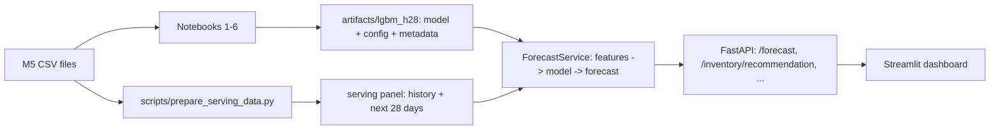

# Retail Demand Forecasting and Inventory Decision Support (M5)

An end-to-end project on the M5 (Walmart) dataset: exploratory analysis, leakage-safe feature engineering, a tuned LightGBM
demand model, a comparison with a foundation model (Chronos-2) and a deep-learning model (TFT), an untouched final holdout,
an assumption-based inventory simulation, and a deployed service (FastAPI + Streamlit + Docker + CI/CD).

> **Scope.** The model uses a stratified sample of **999 California item-store series (about 3.3% of M5's 30,490 series)**.
> The inventory part is a **simulation under stated assumptions**: M5 contains no inventory, lead-time or cost data.

## Results (measured)

| | LightGBM | 28-day moving average |
|---|---|---|
| Final holdout, daily WAPE | **0.744** | 0.789 |
| Final holdout, 7-day-sum WAPE | **0.370** | 0.416 |
| Daily improvement, 95% bootstrap CI | **5.7%** (2.9% to 9.1%) | |

* Model choice: Chronos-2 had a better daily WAPE on the validation folds (0.712) but under-forecast total demand by about 31%; LightGBM won on
  7-day/28-day totals and bias. TFT (one configuration) did not work well.
* Simulated inventory backtest: a 5.7% better forecast changed total simulated cost by only about -1.7% (95% CI -3.2% to -0.3%) and by about 0%
  at equal service level, because demand randomness dominates cost for sparse demand.
* Known weaknesses: sparse/intermittent series (no gain over the baseline), about 7% under-forecast of total demand, new items unsupported.
  See [`docs/MODEL_CARD.md`](docs/MODEL_CARD.md).

## Architecture

